<div align="center">



<a href="https://github.com/sanjayadanushka712/Ghost-Night/stargazers"></a>
<a href="https://github.com/sanjayadanushka712/Ghost-Night/blob/main/LICENSE"></a>


</div>

```
[ OPERATOR ] :: BROWSER FINGERPRINT & IDENTITY ROTATION TOOLKIT
[ TRANSPORT ] :: TOR | OBFS4 | PROXY POOL | DIRECT
[ STATUS     ] :: AUTHORIZED SECURITY TESTING ONLY
```

## Overview

**Ghost Night** is a local-only CLI for authorized security testing. Each session provisions a **coherent browser identity** (matched UA, UA-CH, locale, timezone, screen, GPU, fonts) and routes traffic through **Tor**, **obfs4**, your own **proxy pool**, or **direct**. Run `gn new` to rotate to a completely fresh device+IP identity with zero storage carryover.

## Capabilities

| Signal Tracked | Countermeasure |
|---|---|
| Cookies / localStorage | Fresh isolated browser profile per session |
| Public IP | Tor NEWNYM, obfs4 pluggable transport, or rotating proxy pool |
| WebRTC / DNS leaks | WebRTC disabled, DNS routed through proxy/Tor |
| UA / Client Hints / Viewport / TZ | Coherent device profile; UA ↔ UA-CH parity; version-matched to installed browser |
| Canvas / WebGL | Deterministic-per-session noise, matched vendor/renderer |
| Font enumeration | OS-matched font list; host fonts masked |
| Automation markers | `navigator.webdriver`, `window.chrome`, plugin surface hardened — 56/56 on bot.sannysoft.com |
| Cross-API contradictions | All navigator/screen/device signals unified to one profile |
| IP-geo vs TZ/locale | Exit-country driven timezone/locale when using Tor/proxy |
| TLS/HTTP fingerprints | Real browser TLS (JA3/JA4), HTTP/2 settings, header order preserved |

## Commands

```bash
gn new        # Rotate to fresh identity (new IP + new fingerprint)
gn status     # View current session, transport, fingerprint
gn verify     # Check effective IP vs expected exit
gn fetch      # Raw HTTP with browser-impersonated headers/TLS
gn probe      # Lightweight fingerprint/TLS probe
gn off        # Stop session, clear state
gn doctor     # Dependency & config check
gn test       # Quick sanity checks
```

## Security & Privacy

- **Local-only** — no server, telemetry, or phone-home
- **Ephemeral profiles** — wiped on rotation; `--keep-profiles` opt-in only
- **Evidence aware** — `~/.config/ghost_night/log.jsonl` may be sensitive; handle responsibly
- **HTTPS-first** — Tor exits can see plaintext `http://`; use HTTPS end-to-end
- **JA3 note** — use `socks5://` proxies (not TLS-terminating HTTP proxies) to keep real browser TLS

## Requirements

| Package | Purpose |
|---|---|
| `tor` | Circuit rotation |
| `obfs4proxy` | Obscure Tor from ISP DPI |
| `python >= 3.10` | Runtime |
| `curl` | IP verification |

## License

GPL-3.0 — see [LICENSE](LICENSE).

<div align="center">

<sub>`[ SYS::OK ]`  authorized testing only  `[ SYS::OK ]`</sub>

</div>
